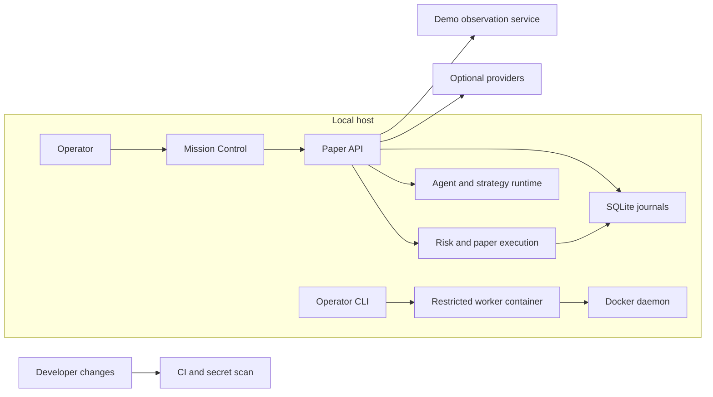

# AI_Quant_OS threat model

> Scope selected by the operator: local, single-operator workstation running PAPER through the loopback launcher. This is repository-grounded threat analysis, not independent security acceptance.

## Executive summary

The selected deployment is one operator on a local workstation using the PAPER launcher. The API and UI bind to loopback, and the deterministic risk/execution path has no live broker execution route. Highest in-scope risks are local credential/session compromise, tampering or rollback of SQLite evidence by a host-level actor, manipulated market/replay inputs, and local resource exhaustion. Remote unauthenticated reads become high priority if the launcher or loopback boundary is bypassed. Optional provider calls and strategy worker containers add data-transfer, spend, archive parsing, and Docker isolation boundaries. Evidence anchors: `src/ai_quant_os/local_runtime.py:LocalSettings`, `src/ai_quant_os/local_api.py:_serve`, `src/ai_quant_os/api.py:create_app`, `src/ai_quant_os/risk.py:RiskKernel`, `src/ai_quant_os/execution.py:PaperExecutionGateway`.

## Scope and assumptions

- **In scope:** Python FastAPI backend and local launcher; Next.js operator UI and same-origin session routes; SQLite paper orders/fills, operator sessions, safety receipts and audit chain; agent/strategy admission; local data/provider integrations; candidate worker image assembly/execution; CI security and test gates.
- **Out of scope:** an unconfirmed cloud deployment, external broker accounts and vendor infrastructure, actual provider billing/data retention, and any live trading operation. Current source reports no live release owner or live execution route: `docs/CONTROL_OWNERSHIP.md`; the execution pack's P13 gate remains required.
- **Deployment:** local single-operator workstation, PAPER mode, using the provided launcher. It binds both services to `127.0.0.1`, filters child-process environment variables, and disables optional providers by default (`src/ai_quant_os/local_runtime.py:LocalSettings.validate`, `LocalSettings.environments`; `src/ai_quant_os/local_api.py:_serve`). This analysis does not assert that an unobserved deployment uses this launcher.
- **Data sensitivity:** use the repository and pack inventory: operator/recovery/session credentials; paper order, fill, account-like, safety, and audit records; market features; strategy source and evaluation artifacts; and optional provider credentials/payloads. Treat credentials and session material as secret, and stored trading/research and audit records as sensitive and integrity-critical. PII or regulated personal data was not identified in the reviewed project documentation; provider retention, data rights, and jurisdictional obligations remain unconfirmed (`docs/SECRETS_AND_COMPLIANCE_GATES.md`). Local ignored environment files were not inspected.
- **Remaining context dependency:** any future shared, remote, or internet-facing deployment requires a fresh threat-model pass. Provider/data retention, licensing, and jurisdiction requirements also need owner confirmation before enabling those integrations with sensitive payloads.

## System model

### Primary components

- **Mission Control UI:** Next.js pages and server-side API routes. Operator session cookies are `HttpOnly`, `SameSite=Strict`, and set `Secure` when the configured origin is HTTPS (`apps/web/src/features/operator-session/server.ts:cookieOptions`). The browser credential boundary validates same-origin requests and only accepts a loopback HTTP backend (`apps/web/src/features/operator-session/boundary.ts`).
- **Paper API:** FastAPI composition root creates the paper world state, risk kernel, broker router, stores, and feature routes (`src/ai_quant_os/api.py:create_app`). The supplied local API launcher binds to loopback (`src/ai_quant_os/local_api.py:_serve`).
- **Deterministic control:** `RiskKernel` validates paper intent decisions; `PaperExecutionGateway` checks kernel-issued approvals and produces simulator receipts; `BrokerRouter` rejects non-PAPER execution routes (`src/ai_quant_os/risk.py:RiskKernel`, `src/ai_quant_os/execution.py:PaperExecutionGateway`, `src/ai_quant_os/broker.py:BrokerRouter`).
- **Native research replay:** pinned Nautilus backtests consume canonical, source-bound recorded quotes. The asynchronous FX portfolio report binds fill prices and cumulative fills to the displayed top-of-book side size and carries explicit schema/replay/liquidity model identifiers; this remains a research result with no broker authority (`src/ai_quant_os/native_tick_evidence.py:canonical_tick_source`, `src/ai_quant_os/native_tick_portfolio.py:run_native_tick_portfolio`, `verify_tick_portfolio_report`).
- **Agent/strategy runtime:** typed graph contexts and registered tools run through `GraphRuntime`; architecture tests prevent agents/strategies from directly importing control modules (`src/ai_quant_os/graph_runtime.py`, `src/ai_quant_os/agent_registry.py`, `tests/test_architecture_broker_boundary.py`).
- **Local persistence:** SQLite stores paper orders/fills, operator sessions, control receipts, and audit events. The audit chain detects local event modification or loss, but is not an external immutable checkpoint (`src/ai_quant_os/order_store.py`, `src/ai_quant_os/operator_session_store.py`, `src/ai_quant_os/paper_state_store.py`, `src/ai_quant_os/audit_chain.py`).
- **Optional integrations and workers:** Jev/reviewer providers are opt-in and spend-admitted; MT5 demo sync is observation-only; strategy workers are assembled from bounded, digest-pinned OCI data and executed with Docker restrictions (`src/ai_quant_os/jev_adapter.py`, `src/ai_quant_os/openai_reviewer.py`, `src/ai_quant_os/mt5_sync_service.py`, `src/ai_quant_os/strategy_image_content.py`, `src/ai_quant_os/strategy_container_lifecycle.py`).
- **Build/CI:** GitHub Actions runs Ruff, tests, web checks, and Gitleaks. CI and developer credentials remain separate from the PAPER runtime (`.github/workflows/ci.yml`).

### Data flows and trust boundaries

- Local operator browser → Next.js UI: HTTP(S) same-origin requests carry credentials only through the session boundary; origin and host must match. Cookie flags reduce script access and cross-site submission risk. Deployment proxy/TLS configuration is not established (`apps/web/src/features/operator-session/boundary.ts`, `server.ts`).
- Next.js server → FastAPI: HTTP to a loopback-only backend origin is enforced by the web boundary and local launcher. Mutations require operator/session authorization; some paper status, order, fill, portfolio, risk, and audit reads are intentionally available without an operator token, which is safe only within the assumed local boundary (`src/ai_quant_os/api.py:822-998`, `apps/web/src/features/operator-session/boundary.ts:backendOrigin`).
- API request → deterministic paper control and SQLite: quote/bar/intent/fill/control payloads cross typed route models into world-state, risk, execution, and durable receipts. Operator mutations are authenticated; risk applies a five-second quote age limit and fixed paper limits (`src/ai_quant_os/api.py:1885-2182`, `RiskKernel` in `src/ai_quant_os/risk.py`, `PaperExecutionGateway` in `src/ai_quant_os/execution.py`).
- Recorded archive → native replay CLI: bounded CSV/archive input is canonicalized before Nautilus runs; output source snapshots and fills are then independently reconciled. The report prevents fills from exceeding the quote-side size supplied by that same source, while source authenticity and actual venue depth remain outside this boundary (`src/ai_quant_os/tick_portfolio_cli.py`, `src/ai_quant_os/native_tick_evidence.py`, `src/ai_quant_os/native_tick_portfolio.py`).
- API → agents/strategies: the server compiles source-bound contexts, enforces registry/tool permissions and validates output models. Agent/strategy modules cannot directly import broker/execution control modules; indirect runtime behavior still needs broader independent review (`src/ai_quant_os/graph_runtime.py`, `src/ai_quant_os/agent_permissions.py`, `tests/test_architecture_broker_boundary.py`).
- Backend → external providers/data services: when explicitly enabled, paper market features or compact review evidence may be sent to external providers; credentials are server-side and provider spending is reserved before calls. Actual invoice correspondence and provider retention are not established (`src/ai_quant_os/jev_adapter.py`, `src/ai_quant_os/openai_reviewer.py`, `src/ai_quant_os/provider_spend_store.py`).
- Operator CLI → Docker worker: an operator-selected validation package and pinned image inputs cross into a container with network disabled, read-only root, non-root user, dropped capabilities, and bounded CPU/memory/processes. Archive sizes are bounded. Docker daemon, host kernel, and local workspace remain in the trust base (`src/ai_quant_os/strategy_container_cli.py`, `src/ai_quant_os/strategy_container_lifecycle.py`, `src/ai_quant_os/strategy_image_content.py`).
- Developer changes → GitHub Actions: source and dependency configuration are tested and scanned for committed secrets. CI results do not prove production deployment isolation or third-party terms (`.github/workflows/ci.yml`).

#### Diagram

## Assets and security objectives

| Asset | Why it matters | Security objective (C/I/A) |
| --- | --- | --- |
| Operator and recovery credentials; session tokens | Control paper mutations, safety changes, recovery and session revocation | C/I |
| Paper intents, orders, fills, positions and risk state | Establish what the simulator accepted and what later research reports | I/A |
| Audit chain, operator/session receipts and recovery records | Detect tampering and reconstruct safety decisions | I/A |
| Market data, strategy source, evaluation packages and agent contexts | Influence paper decisions and conclusions; may contain licensed/private inputs | C/I |
| Provider credentials, spending policy and external payloads | Enable paid data transfer and create billing or retention exposure | C/I/A |
| Local runtime, SQLite files, CI artifacts and Docker worker | Availability and provenance of the paper system and test evidence | I/A |

## Attacker model

### Capabilities

- A remote unauthenticated actor if the API or UI is exposed beyond the loopback launcher.
- A local unprivileged process/user on a shared workstation or staging host.
- A user able to submit malformed or stale market/agent/strategy inputs through an authorized workflow.
- A malicious or compromised provider, data package, strategy source, or dependency within the limits of its enabled integration.
- A contributor who can submit source changes to the CI pipeline, subject to repository protections not verified here.

### Non-capabilities

- The observed paper gateway has no live broker execution path or live release owner; an attacker cannot send real broker orders through this code as inspected (`src/ai_quant_os/broker.py:BrokerRouter`, `docs/CONTROL_OWNERSHIP.md`).
- Agent and strategy outputs cannot directly authorize risk or import broker/execution control modules (`src/ai_quant_os/agent_permissions.py`, `tests/test_architecture_broker_boundary.py`).
- The provided local launcher does not expose the API on a public interface; this non-capability is conditional on that launcher being used (`src/ai_quant_os/local_runtime.py`, `src/ai_quant_os/local_api.py`).
- No live account credentials or actual local secret values were inspected, so their presence and compromise are not assumed.

## Entry points and attack surfaces

| Surface | How reached | Trust boundary | Notes | Evidence (repo path / symbol) |
| --- | --- | --- | --- | --- |
| Paper API read routes | HTTP GET from UI or local client | Local client → API | Risk, broker, market, orders, fills, portfolio, audit, status and world-state reads include unauthenticated routes | `src/ai_quant_os/api.py:822-1080` |
| Paper mutation and safety routes | HTTP POST from operator UI/client | Operator → API → deterministic control | Quotes, bars, intents, fills, reconcile, HALT/NO_NEW_RISK/FLATTEN_ONLY | `src/ai_quant_os/api.py:1885-2182`; `OperatorAuthorization` in `src/ai_quant_os/operator_session_api.py` |
| Operator session routes | HTTP login/session/revoke | Browser → Next server → session API | Direct shared token issues a session; session and selected revocation actions require reauthentication | `src/ai_quant_os/operator_session_api.py:OperatorAuthorization.install` |
| Agent/strategy and research APIs | Authenticated HTTP plus compiled task context | Operator/API → graph/runtime/stores | Context compilation, execution, research/candidate creation and archive reads | `src/ai_quant_os/api.py:1241-1860`; feature `*_api.py` modules |
| Candidate, image and repair workflows | Operator CLI and bounded archive/path arguments | Local operator/filesystem → parser/container | Digest pins, archive size/expanded-size limits and constrained Docker worker reduce risk; host and daemon remain trusted | `src/ai_quant_os/strategy_container_cli.py`; `src/ai_quant_os/strategy_image_content.py`; `src/ai_quant_os/repair_cli.py` |
| Data, backtest and recovery CLIs | Local shell arguments, files, environment and optional subprocess | Operator/filesystem → parser or local service | Fixture/data import, simulations and recovery tools are outside the browser auth boundary | `pyproject.toml:[project.scripts]`; `src/ai_quant_os/data_cli.py`; `src/ai_quant_os/local_cli.py` |
| Optional provider/demo integrations | Environment credentials and outgoing HTTPS/local service calls | Backend → vendor or demo service | Disabled by default in local launcher; demo sync is observation-only | `src/ai_quant_os/jev_adapter.py`; `src/ai_quant_os/openai_reviewer.py`; `src/ai_quant_os/mt5_sync_service.py` |
| CI and build pipeline | Source changes and dependency manifests | Contributor → GitHub Actions | Ruff/tests/web checks plus Gitleaks; repository branch protection and artifact signing were not verified | `.github/workflows/ci.yml` |

## Top abuse paths

1. **Expose unauthenticated paper reads:** misconfigure the API on a reachable interface → remote actor queries orders, fills, positions, strategy/evidence or audit endpoints → disclose operational and research data.
2. **Steal operator authority:** compromise workstation/environment or expose session/token handling → call authenticated quote, intent, recovery, or safety routes → corrupt paper state and evidence (no live order path observed).
3. **Poison paper inputs:** authorized or compromised client submits manipulated quotes/bars/fills → resulting paper world state and evaluation evidence are misleading; freshness and risk checks reduce but do not establish source truth.
4. **Rewrite local history:** obtain write access to SQLite/state files → alter data and recompute a local hash chain or restore an older consistent database → hide or falsify local paper history; no remote checkpoint currently anchors the chain.
5. **Abuse candidate processing:** provide a crafted archive or hostile strategy worker → exploit a parser, Docker/host boundary, or resource limit → compromise the local operator host or exhaust resources; bounded archives and constrained worker settings reduce exposure.
6. **Leak data or incur spend through providers:** obtain provider enablement/credential or alter its configuration → send market/review evidence to the vendor and consume paid capacity → disclose data or create cost; opt-in settings and spending reservations reduce but do not prove provider retention or invoice correspondence.
7. **Exhaust local service capacity:** submit expensive API/agent/research workloads or large valid inputs → consume CPU, memory, SQLite locks, or disk → paper UI/service unavailable; no deployment-wide rate limit or resource budget was confirmed.

## Threat model table

| Threat ID | Threat source | Prerequisites | Threat action | Impact | Impacted assets | Existing controls (evidence) | Gaps | Recommended mitigations | Detection ideas | Likelihood | Impact severity | Priority |
| --- | --- | --- | --- | --- | --- | --- | --- | --- | --- | --- | --- | --- |
| TM-001 | Remote unauthenticated actor | API reachable outside loopback; several read routes do not require operator auth | Enumerate status, risk, order/fill, portfolio, world-state and audit reads | Confidentiality loss for paper and research records | Orders, fills, market data, audit | Local launcher binds `127.0.0.1`; web backend origin is loopback; mutation routes require operator/session (`local_api.py`, `local_runtime.py`, `api.py`) | Direct app deployment has no verified network policy; read APIs are intentionally unauthenticated | Bind behind an authenticated reverse proxy; private network allowlist; require auth for sensitive reads if shared; TLS and request logging | Network exposure scan; monitor unauthenticated read volume and source addresses | Low under verified local launcher; unknown otherwise | High if remotely exposed | high |
| TM-002 | Credential thief or brute-force client | Access to token/session material or a reachable login/control endpoint | Reuse shared operator token/session to submit paper inputs, alter safety state or recover sessions | Paper state/evidence corruption and denial of service; no live execution observed | Operator credentials, risk state, orders, audit | Constant-time credential comparison; distinct recovery token; backend-owned expiring sessions; reauthentication and same-origin checks; local launcher filters child environment (`operator_session_api.py`, web session boundary) | No named production identities, MFA, global rate limit or production secret manager confirmed | Keep local single-user boundary; use managed identity/MFA and short revocable sessions for staging; rate-limit authentication; rotate credentials and alert on repeated failures | Failed-auth bursts, unexpected session issue/revoke, safety transitions | Low locally; medium if exposed or shared | High for integrity/availability | medium |
| TM-003 | Local host user or process | Write access to SQLite/state directory or ability to restore backups | Edit/replace order, fill, audit or session records; recompute chain or restore an old consistent copy | Loss of trustworthy history and incorrect research/incident conclusions | SQLite journals and audit evidence | Transactions, consistency checks and local hash chain detect ordinary modification and missing events (`paper_state_store.py`, `audit_chain.py`) | No independent immutable remote checkpoint; host administrator can alter both records and chain | Restrict filesystem ACLs; encrypted backups; append-only off-host checkpoints with independent access; test restore and chain comparison | Compare signed/off-host head checkpoints; alert on DB replacement and unexpected file rollback | Medium on shared/compromised host | High for integrity | high |
| TM-004 | Authorized user, compromised data source, or local client | Ability to submit market/fill inputs or alter upstream data | Feed manipulated/stale but structurally valid prices or sizes into PAPER state or recorded replay | Invalid paper risk/evaluation outcomes; source-visible sizes can still overstate real venue liquidity; no real capital loss through the observed route | Market snapshots, quote sizes, decisions, fills, strategy evaluation | Strict typed models, trusted flags, world-state version checks, five-second quote freshness, deterministic risk gate, and per-quote side-size fill reconciliation (`api.py`, `market.py`, `risk.py`, `native_tick_evidence.py`, `native_tick_portfolio.py`) | Operator submission is not independent provenance; no external source attestation; top-of-book only, with no deeper-depth or measured-latency evidence; demo health metrics remain partly unassessed | Bind inputs to signed/provider source identity and time; keep independent raw feed receipts; compare venue-observed execution/depth before treating replay capacity as representative; reject unsupported symbols and reconcile provider snapshots | Track source, age, sequence gaps, displayed-size outliers, rejection rates, and independent fill mismatches | Medium | Medium | medium |
| TM-005 | Malicious strategy package or archive | Operator runs candidate workflow on a host with Docker; parser or daemon/kernel has a weakness | Exploit archive handling or escape resource/network/user restrictions | Local host compromise or resource exhaustion; candidate results may be forged | Host, Docker daemon, candidate artifacts, CI/operator workspace | Digest/source pins, bounded compressed/expanded input, no-network/read-only/non-root worker, dropped capabilities and CPU/memory/PID limits (`strategy_image_content.py`, `strategy_container_lifecycle.py`) | Docker daemon and host kernel remain trusted; worker output is explicitly unattested; not all archive paths/runtime inputs were independently reviewed | Keep workers disposable; separate untrusted candidate execution from operator credentials/state; patch and harden Docker; verify every archive path and resource cap in an isolated security review | Container escape/runtime alerts, daemon audit, archive rejection and resource-limit events | Low to medium; depends on use of candidate execution | High | medium |
| TM-006 | Optional provider compromise or configuration error | Provider flag/key enabled and outbound access allowed | Send paper features/review evidence to vendor or trigger unplanned calls | Data disclosure, provider-side retention, cost or availability impact | Market/review payloads, provider keys, spend reserve | Disabled by default in local launcher; keys remain server-side; bounded request and spending admission (`local_runtime.py`, `jev_adapter.py`, `openai_reviewer.py`, provider spend modules) | Actual provider retention, data-use permission, invoices and all-provider spending coverage remain unverified | Review provider terms/data classification; narrow payloads; secret manager and egress allowlist; cap by role/day/month; test key revocation and unknown-charge handling | Provider call/cost ledger reconciliation, unexpected egress, budget breach and key-use alerts | Low while disabled; medium if enabled | Medium | medium |
| TM-007 | Local or remote workload sender | Reachable API/CLI and expensive valid task or file input | Repeated agent/research/validation requests or large inputs to consume CPU, disk, SQLite and worker capacity | Local paper service outage and lost operator visibility | API, SQLite, workers, local host | Schema and archive bounds; agent-call budgets; worker resource limits; local launcher ports and process ownership (`agent_call_budgets.py`, `strategy_image_content.py`, `local_runtime.py`) | No global API rate limit; deployment-wide concurrency and disk quotas not established | Add per-identity request/concurrency limits, global body/time budgets, disk quotas, and bounded job queues before shared staging | Queue depth, request duration, SQLite busy/errors, disk usage, worker limits and 429 rates | Medium if reachable | Medium | medium |

## Criticality calibration

Severity and priority below use the provisional single-operator local PAPER assumption. Internet exposure or multiple users raises likelihood for API and credential threats.

- **Critical:** (1) a remotely reachable path that submits real orders without signed P13 approval; (2) theft or misuse of production broker credentials that can place real orders. Neither live execution nor a production release owner was found in the inspected repository; these are future release-blocking scenarios, not current findings.
- **High:** operator-control compromise that changes persistent safety/order evidence; or remote unauthenticated access to sensitive paper records if the API is exposed. Examples: stolen recovery token, exposed order/audit read endpoints, host-level replacement of SQLite evidence.
- **Medium:** inaccurate paper results from manipulated inputs; provider data/cost exposure; local service exhaustion or candidate worker isolation failure. These can block reliable research and operations but do not currently authorize real orders.
- **Low:** isolated malformed requests rejected by strict schemas, or disclosure of non-sensitive local health/status metadata to another local user. Repeated failures can raise these to medium through resource impact.

## Focus paths for security review

| Path | Why it matters | Related Threat IDs |
| --- | --- | --- |
| `src/ai_quant_os/api.py` and `src/ai_quant_os/operator_session_api.py` | Route authentication, public read inventory, token/session lifetime, mutation authorization | TM-001, TM-002, TM-004 |
| `src/ai_quant_os/local_runtime.py` and `src/ai_quant_os/local_api.py` | The loopback boundary and child environment define the current local security assumption | TM-001, TM-002, TM-007 |
| `src/ai_quant_os/risk.py`, `execution.py`, `broker.py` | Deterministic paper authority and no-live enforcement | TM-002, TM-004 |
| `src/ai_quant_os/paper_state_store.py`, `order_store.py`, `audit_chain.py`, `operator_session_store.py` | Durable safety/order/audit/session integrity and rollback behavior | TM-002, TM-003 |
| `src/ai_quant_os/strategy_image_content.py`, `strategy_container_lifecycle.py`, `repair_transport.py` | Archive parsing, command construction, Docker isolation, and host boundary | TM-005, TM-007 |
| `src/ai_quant_os/jev_adapter.py`, `openai_reviewer.py`, `provider_spend_store.py`, `mt5_sync_service.py` | Outbound data, credentials, opt-in state, spend accounting, and demo observation | TM-006 |
| `.github/workflows/ci.yml`, dependency manifests, `tests/test_architecture_broker_boundary.py` | CI secret scan, test gate, dependency provenance, and static import boundary | TM-005, TM-006 |

## Notes on use

- **Scope status:** operator selected local, single-operator PAPER workstation use. Likelihood and priority reflect that scope; TM-001 and TM-002 retain conditional higher risk if the loopback boundary is bypassed or deployment changes.
- **Runtime versus tooling:** HTTP/SQLite/provider flows are runtime. Candidate CLI/container execution is a local operator workflow. GitHub Actions is a build boundary. Test fixtures and test credentials are not production integrations.
- **Review coverage:** this is repository-grounded static analysis, not a penetration test, runtime configuration audit, vendor review, or independent critical-path approval. Confirm every app route's auth behavior and examine the full Docker/archive and launch/deployment configuration before accepting P00.
- **Open assumptions:** verify runtime configuration on the actual workstation; confirm provider/data payload jurisdiction, license, privacy, and retention constraints before enabling external integrations; repeat this analysis for any shared or remote deployment.
